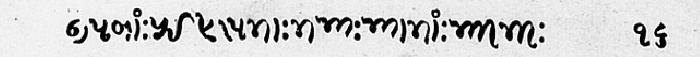
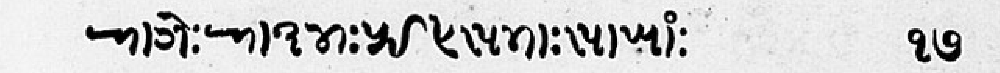
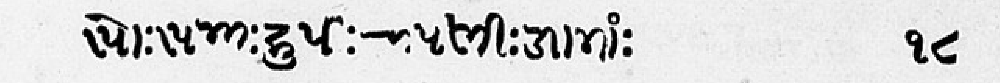
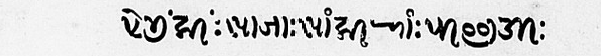
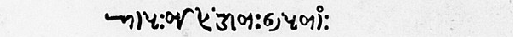

# khojki-ocr

A small OCR pipeline for printed Khojki. It finds text lines on a scanned page, reads them with a kraken model trained only on synthetic lines, and writes Unicode that passes a Khojki validator.

The test set is 5 lines I verified by hand from page 18 of a 1903 metal-type book (Pir Imam Shah, contents page). On those lines the model gets <!-- VAL:cer_b -->21.8% (26/119)<!-- /VAL:cer_b --> CER from hand-cropped lines and <!-- VAL:cer_a -->18.5% (22/119)<!-- /VAL:cer_a --> from the pipeline's own line crops. Five lines from one page is a small test set, so treat these numbers as a rough guide.

```
 page_XX.png (300 DPI, grayscale)
      │
      ▼
 segment.py     Sauvola binarisation → printed frame → deskew → row profile → line boxes
      │
      ▼
 recognize.py   kraken VGSL model (trained from scratch on rendered + damaged lines)
      │
      ▼
 normalize.py   NFC, decomposed-vowel repair, digit/punctuation mapping, mark order
      │
      ▼
 validate.py    illegal code points, orphan marks, mark order, do-not-use sequences
      │
      ▼
 score.py       re-render the text in Noto Sans Khojki, compare with the crop (1 − IoU)
      │
      ▼
 results/out/page_XX.{txt,json}, page_XX_overlay.png
```

## Quick start

kraken only runs on Linux and macOS. On Windows, use WSL2 (tested on Ubuntu 24.04, Python 3.12). Pillow needs libraqm (through libfribidi and HarfBuzz) to shape Khojki; `make setup` checks this and stops if it is missing.

```bash
# 1. environment
make setup

# 2. put the sample PDF at inputs/sample_khojki_script_vatiations.pdf, then render pages
make pages

# 3. synthetic training data (corpus text → damaged and clean line images)
make synth

# 4. train (GPU recommended; the caps are 35 and 20 minutes)
make train
make train-clean

# 5. run the pipeline on page 18, evaluate, rebuild the tables in this README, run tests
make all

# other pages
make run PAGES="01 09 18"
```

The trained model `models/khojki_best.mlmodel` is in the repo, so steps 3 and 4 are optional. Without them, `make pages all` reproduces every number below.

On WSL2, keep the virtualenv and `data/synth/` on the Linux filesystem (symlinks are fine). Under `/mnt/c`, the torch install and imports were very slow.

## Results

All numbers in this section are written by `tools/make_tables.py` from files in `results/`. CER is Levenshtein edits divided by the number of reference units.

Run A uses the pipeline's own line boxes, matched to the hand-cropped boxes by IoU ≥ 0.5. Run B uses the hand-cropped (oracle) boxes and normalises the output. Run C uses the oracle boxes and keeps the raw model output, so the gap between B and C is what normalisation fixed.

<!-- TABLE:cer -->
| Model | Run | CER (code points) | CER without U+1123A | CER (graphemes) |
|---|---|---|---|---|
| damaged | A: auto line crop + normalize | 18.5% (22/119) | 19.4% (19/98) | 26.8% (22/82) |
| damaged | B: oracle crop + normalize | 21.8% (26/119) | 23.5% (23/98) | 31.7% (26/82) |
| damaged | C: oracle crop, raw model output | 21.8% (26/119) | 23.5% (23/98) | 31.7% (26/82) |
| clean (did not converge: 2 epochs vs 23) | A: auto line crop + normalize | 98.3% (117/119) | 98.0% (96/98) | 100.0% (82/82) |
| clean (did not converge: 2 epochs vs 23) | B: oracle crop + normalize | 99.2% (118/119) | 99.0% (97/98) | 100.0% (82/82) |
| clean (did not converge: 2 epochs vs 23) | C: oracle crop, raw model output | 99.2% (118/119) | 99.0% (97/98) | 100.0% (82/82) |
| VLM baseline | Not run (no API key). GlotOCR Bench (arXiv 2604.12978) reports all 14 tested systems score 0 on Khojki; not verified here. |  |  |  |
<!-- /TABLE:cer -->

Per line, damaged-data model, run B:

<!-- TABLE:lines -->
| Line | N | Edits (B) | CER (B) | Render score | Auto-box IoU | Output (B) |
|---|---|---|---|---|---|---|
| p18_l02 | 28 | 5 | 17.9% | 0.769 | 0.943 | 𑈃𑈟𑈬𑈴𑈺𑈠𑈭𑈦𑈩𑈙𑈬𑈺𑈙𑈡𑈺𑈡𑈬𑈙𑈬𑈴𑈺𑈡𑈮𑈙𑈮𑈺૪ |
| p18_l03 | 23 | 4 | 17.4% | 0.7483 | 0.917 | 𑈁𑈬𑈊𑈰𑈺𑈁𑈛𑈤𑈺𑈠𑈭𑈦𑈩𑈙𑈬𑈺𑈩𑈬𑈚𑈬𑈴૭𑈯 |
| p18_l04 | 23 | 4 | 17.4% | 0.8041 | 0.868 | 𑈩𑈬𑈺𑈩𑈡𑈺𑈪𑈯𑈟𑈭𑈺𑈀𑈟𑈘𑈮𑈺𑈐𑈬𑈙𑈬𑈴𑈺૮ |
| p18_l05 | 29 | 8 | 27.6% | 0.6582 | 0.864 | 𑈦𑈰𑈙𑈯𑈴𑈌𑈮𑈴𑈺𑈩𑈬𑈎𑈬𑈺𑈩𑈶𑈪𑈮𑈁𑈴𑈺𑈉𑈮𑈥𑈯𑈐𑈮𑈺 |
| p18_l06 | 16 | 5 | 31.2% | 0.6917 | 0.811 | 𑈁𑈟𑈺𑈑𑈭𑈦𑈭𑈴𑈐𑈮𑈿𑈺𑈃𑈟𑈞𑈬𑈴 |
<!-- /TABLE:lines -->

Where the errors come from (damaged model):

<!-- TABLE:stages -->
| Stage | Edits | Share |
|---|---|---|
| line detection | -4 | 0% |
| mapping | 0 | 0% |
| recognition | 26 | 100% |
<!-- /TABLE:stages -->

"Line detection" is the gap between runs A and B. A negative value means the automatic crops scored better than the hand crops. "Mapping" is the gap between runs C and B, plus edits where the two code points draw the same glyph in the font. "Recognition" is everything else in run B.

Most frequent confusions in run B:

<!-- TABLE:confusions -->
| # | Ground truth | Predicted | Count |
|---|---|---|---|
| 1 | (none) | U+1122D KHOJKI VOWEL SIGN I | 2 |
| 2 | U+1121E KHOJKI LETTER NA | (none) | 1 |
| 3 | (none) | U+11219 KHOJKI LETTER TA | 1 |
| 4 | U+11221 KHOJKI LETTER BA | U+1122E KHOJKI VOWEL SIGN II | 1 |
| 5 | U+0AE7 GUJARATI DIGIT ONE | U+0AEA GUJARATI DIGIT FOUR | 1 |
| 6 | U+0AEC GUJARATI DIGIT SIX | (none) | 1 |
| 7 | (none) | U+1122C KHOJKI VOWEL SIGN AA | 1 |
| 8 | U+1123A KHOJKI WORD SEPARATOR | U+0AED GUJARATI DIGIT SEVEN | 1 |
| 9 | U+0AE7 GUJARATI DIGIT ONE | U+1122F KHOJKI VOWEL SIGN U | 1 |
| 10 | U+0AED GUJARATI DIGIT SEVEN | (none) | 1 |
<!-- /TABLE:confusions -->

Line detection on page 18: the pipeline found <!-- VAL:auto_lines -->16<!-- /VAL:auto_lines --> lines; a manual count gives <!-- VAL:manual_lines -->16<!-- /VAL:manual_lines -->. <!-- VAL:matched -->5<!-- /VAL:matched --> of the 5 test lines have a matching automatic box.

Render score against line CER (Spearman): <!-- VAL:spearman -->-0.718<!-- /VAL:spearman -->. With 5 lines this cannot show whether the render score works as a confidence signal.

Training (validation split is 10% of the synthetic lines):

| Model | Val CER (synthetic) | Epochs | Minutes |
|---|---|---|---|
| damaged | <!-- VAL:val_cer_damaged -->0.3%<!-- /VAL:val_cer_damaged --> | <!-- VAL:epochs_damaged -->23<!-- /VAL:epochs_damaged --> | <!-- VAL:train_min_damaged -->31<!-- /VAL:train_min_damaged --> |
| clean | <!-- VAL:val_cer_clean -->29.2%<!-- /VAL:val_cer_clean --> | <!-- VAL:epochs_clean -->2<!-- /VAL:epochs_clean --> | <!-- VAL:train_min_clean -->20<!-- /VAL:train_min_clean --> |

Pages run through the full pipeline (<!-- VAL:device -->cpu<!-- /VAL:device -->):

<!-- TABLE:pages -->
| Page | Lines found | Seconds | Lines with validator errors | Error kinds |
|---|---|---|---|---|
| page_01.png | 11 | 8.4 | 6 | vowel signs on one letter (8), orphan mark (2) |
| page_09.png | 12 | 12.5 | 5 | orphan mark (9), vowel signs on one letter (5) |
| page_18.png | 16 | 8.0 | 6 | vowel signs on one letter (4), orphan mark (3) |
<!-- /TABLE:pages -->

Pages 1 and 9 have no ground truth. Their only check is the validator.

VLM baseline: <!-- VAL:vlm_cer -->Not run (no API key). GlotOCR Bench (arXiv 2604.12978) reports all 14 tested systems score 0 on Khojki; not verified here.<!-- /VAL:vlm_cer --> `tools/vlm_baseline.py` is ready to run once a key is set.

Every experiment, including the ones that failed:

<!-- TABLE:experiments -->
| Date | Experiment | Settings | Metric | Value | Minutes |
|---|---|---|---|---|---|
| 2026-10-31 | corpus | guj=300 per_cell=20 punct=600 seed=7 | codepoint_coverage_pct | 100.0 | 0.02 |
| 2026-10-31 | render_damaged | n=10000 font=28-48px height=120 seed=11 | images | 10000 | 0.51 |
| 2026-10-31 | render_clean | n=4000 font=28-48px height=120 seed=11 | images | 4000 | 0.17 |
| 2026-10-31 | vlm_baseline | no API key | status | skipped | 0 |
| 2026-11-01 | train_damaged | from scratch, 10000 damaged lines, batch 16, early stop lag 5, cap 35 min | val_cer | 0.0031 | 31 |
| 2026-11-01 | train_clean_10min | from scratch, 4000 clean lines, batch 16, cap 10 min | val_accuracy_after_2_epochs | 0.0 | 10 |
| 2026-11-01 | gate_khojki_best_on_damaged | last 20 lines, ketos test | char_accuracy_pct | 99.82 | 0 |
| 2026-11-01 | gate_khojki_best_on_clean | last 20 lines, ketos test | char_accuracy_pct | -28.54 | 0 |
| 2026-11-01 | train_clean_20min | from scratch, 4000 clean lines, batch 16, early stop lag 5, cap 20 min | val_cer | 0.2916 | 20 |
| 2026-11-01 | gate_khojki_clean_on_clean | last 20 lines, ketos test | char_accuracy_pct | 68.99 | 0 |
<!-- /TABLE:experiments -->

## Test lines

<!-- TABLE:testlines -->
| Line | Scan | Unicode | Code points |
|---|---|---|---|
| `p18_l02` |  | 𑈃𑈟𑈞𑈬𑈴𑈺𑈠𑈭𑈦𑈩𑈙𑈬𑈺𑈙𑈡𑈺𑈡𑈬𑈙𑈬𑈴𑈺𑈡𑈮𑈡𑈺૧૬ | <sub>U+11203 U+1121F U+1121E U+1122C U+11234 U+1123A U+11220 U+1122D U+11226 U+11229 U+11219 U+1122C U+1123A U+11219 U+11221 U+1123A U+11221 U+1122C U+11219 U+1122C U+11234 U+1123A U+11221 U+1122E U+11221 U+1123A U+0AE7 U+0AEC</sub> |
| `p18_l03` |  | 𑈁𑈊𑈰𑈺𑈁𑈛𑈤𑈺𑈠𑈭𑈦𑈩𑈙𑈬𑈺𑈩𑈬𑈚𑈬𑈴𑈺૧૭ | <sub>U+11201 U+1120A U+11230 U+1123A U+11201 U+1121B U+11224 U+1123A U+11220 U+1122D U+11226 U+11229 U+11219 U+1122C U+1123A U+11229 U+1122C U+1121A U+1122C U+11234 U+1123A U+0AE7 U+0AED</sub> |
| `p18_l04` |  | 𑈩𑈲𑈺𑈩𑈡𑈺𑈪𑈯𑈟𑈺𑈀𑈟𑈙𑈮𑈺𑈐𑈬𑈙𑈬𑈴𑈺૧૮ | <sub>U+11229 U+11232 U+1123A U+11229 U+11221 U+1123A U+1122A U+1122F U+1121F U+1123A U+11200 U+1121F U+11219 U+1122E U+1123A U+11210 U+1122C U+11219 U+1122C U+11234 U+1123A U+0AE7 U+0AEE</sub> |
| `p18_l05` |  | 𑈨𑈰𑈐𑈯𑈴𑈪𑈮𑈴𑈺𑈩𑈬𑈐𑈬𑈺𑈩𑈬𑈴𑈪𑈮𑈁𑈴𑈺𑈚𑈮𑈥𑈯𑈐𑈙𑈺 | <sub>U+11228 U+11230 U+11210 U+1122F U+11234 U+1122A U+1122E U+11234 U+1123A U+11229 U+1122C U+11210 U+1122C U+1123A U+11229 U+1122C U+11234 U+1122A U+1122E U+11201 U+11234 U+1123A U+1121A U+1122E U+11225 U+1122F U+11210 U+11219 U+1123A</sub> |
| `p18_l06` |  | 𑈁𑈟𑈺𑈞𑈭𑈦𑈴𑈐𑈞𑈺𑈃𑈟𑈞𑈬𑈴𑈺 | <sub>U+11201 U+1121F U+1123A U+1121E U+1122D U+11226 U+11234 U+11210 U+1121E U+1123A U+11203 U+1121F U+1121E U+1122C U+11234 U+1123A</sub> |
<!-- /TABLE:testlines -->

The crops are in `data/gt_lines/`. Their boxes on the 400 DPI page are in `results/oracle_check.json`.

## How the ground truth was made

I verified every test line glyph by glyph against the scan. `tools/compare.py` draws a transcription in Noto Sans Khojki directly under the scan crop (`*.check.png`); I compare the two, fix the line with `tools/ktype.py`, and render again until every glyph matches.

I started from an AI-drafted transcription. My check changed <!-- VAL:draft_lines_changed -->4 of 5<!-- /VAL:draft_lines_changed --> lines, and the draft had <!-- VAL:draft_cer -->10.1% (12/119)<!-- /VAL:draft_cer --> CER against the verified text. The corrections were kha/pha/tha and ma/ta confusions, a missed anusvara, a missed II sign, and three misread glyphs in one line. I also settled that the hollow ring above the vowel bar is anusvara, not the abbreviation sign, which fixed an encoding rule. Two glyphs are still uncertain. `GROUND_TRUTH.md` lists every correction and the evidence for it.

Labelling time: only my first full check was measured. Finding and fixing errors in all 5 lines took about <!-- VAL:first_check_min -->34<!-- /VAL:first_check_min --> minutes, or about <!-- VAL:first_check_per_line -->7<!-- /VAL:first_check_per_line --> minutes per line (self-reported, not tool-timed; `results/labelling_manual.json`). The cost estimate in the retro uses this figure.

## Encoding decisions

| Question | Decision | Why |
|---|---|---|
| Word separator | U+1123A KHOJKI WORD SEPARATOR, never a space or ASCII colon | It is the script's own separator, and the print uses it between every word |
| Section mark U+1123B | Never used as a word separator | It is a different sign; the validator flags it between letters |
| Digits | Gujarati U+0AE6 to U+0AEF | The book prints Gujarati digits; ASCII and Devanagari digits are mapped |
| Gap before a page number | Not encoded; the line ends with U+1123A, then the digits | Spacing is layout, not text |
| Vowel signs | Atomic code points only | Unicode 17.0 Table 15-4 lists eight decomposed sequences as "do not use"; `normalize.py` repairs all eight |
| Order of marks | Nukta, then vowel sign, then anusvara and the rest | Canonical order for shaping; out-of-order marks are reordered and counted |
| Hollow ring above the vowel bar | Anusvara U+11234, not abbreviation sign U+1123D | The font draws U+1123D on the baseline; the ring sits where anusvara goes |
| Normal form | NFC | kraken trains with `-u NFC`; the validator rejects anything else |
| U+11241 VOWEL SIGN VOCALIC R | Allowed, but kept out of training text | Noto Sans Khojki v2.005 has no glyph for it (`results/font_coverage.txt`) |
| Shadda or virama after a vowel sign | Kept out of training text | HarfBuzz draws a dotted circle there, which would teach the model a broken glyph |

All code points were checked with `unicodedata.name()`, not from memory. Where an AI tool got a code point or rule wrong, it is logged in `AI_ERRORS.md`.

## Limitations

- Five test lines. The test set has <!-- VAL:n_cp -->119<!-- /VAL:n_cp --> code points, so each edit counts for a lot. All 5 lines come from one page of one book.
- No real training data. The model has only seen Noto Sans Khojki, a modern design whose letter shapes differ from 1903 metal type. Most remaining errors are on those letters.
- Damage only on textured paper. Every damaged training line has a paper texture. The damaged model fails on clean white renders (see the `gate_*` rows in the experiments table), so it has learned the background as well as the glyphs.
- Segmentation is tuned to framed pages. It looks for a printed border and returns no lines on a blank page. It has not been tried on lithographs or handwriting.
- The render score is unproven. Five lines are too few to tell whether it predicts errors.
- No VLM comparison, because no API key was available. A published benchmark result is quoted above but was not checked here.
- Two glyphs in the ground truth are still uncertain (see `GROUND_TRUTH.md`).

## Repository layout

```
khojki/        charset, validate, normalize, segment, corpus, render, recognize, score, evaluate
pipeline.py    page → lines → text, with timing
tools/         page rendering, font coverage, oracle crops, GT helpers, training, tables
tests/         Unicode layer and segmentation tests (pytest)
data/gt_lines/ test line crops, ground truth, check images
data/gt_draft/ the starting draft, kept to reproduce the draft-vs-verified CER
results/       every number in this README, plus overlays and samples
models/        khojki_best.mlmodel (damaged data), khojki_clean.mlmodel (clean data)
```

## Data notice

The source PDF and full page scans are not included. They are not ours to redistribute. The repo holds only the 5 test-line crops and quarter-scale overlays, which are needed to review the results. Noto Sans Khojki is under the SIL Open Font License 1.1. The Gujarati text in the synthetic corpus comes from Narsinh Mehta poems on Gujarati Wikisource, transliterated with aksharamukha. The corpus has <!-- VAL:corpus_lines -->2071<!-- /VAL:corpus_lines --> lines and covers <!-- VAL:corpus_cov -->100.0%<!-- /VAL:corpus_cov --> of the code points the font can draw. See `NOTICE.md` for details. The code is MIT-licensed.
